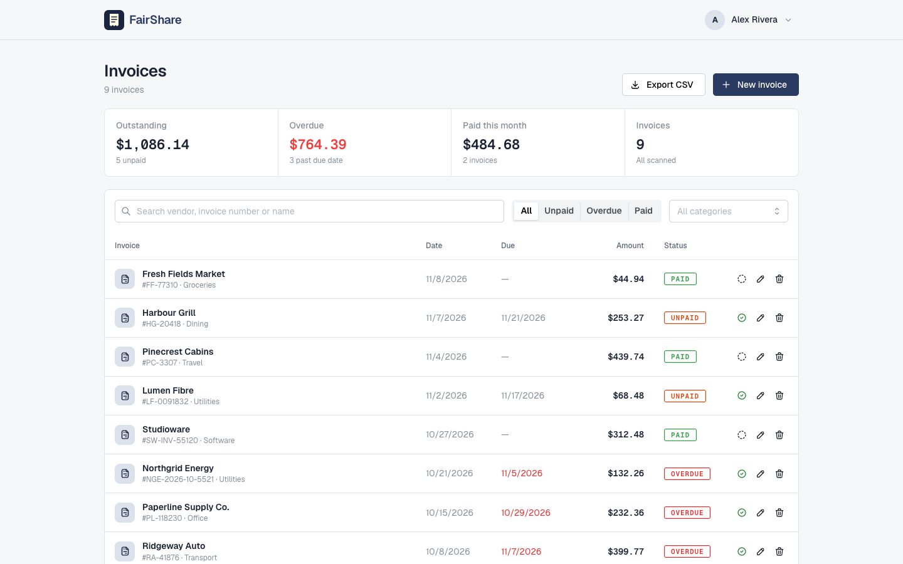
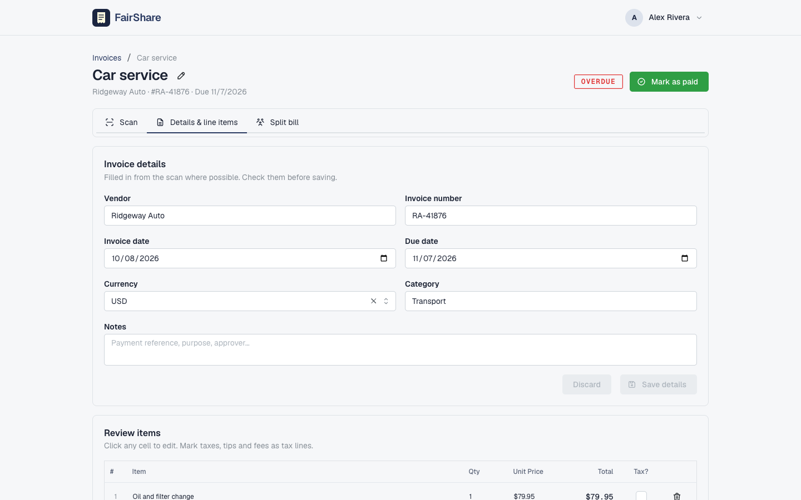
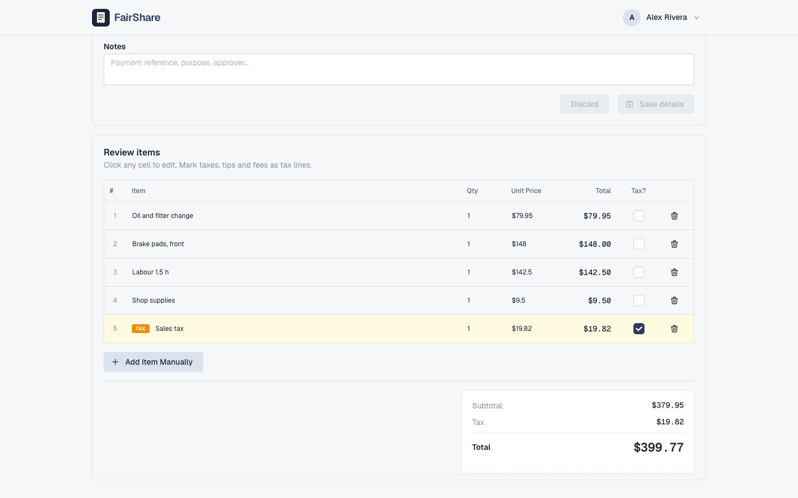
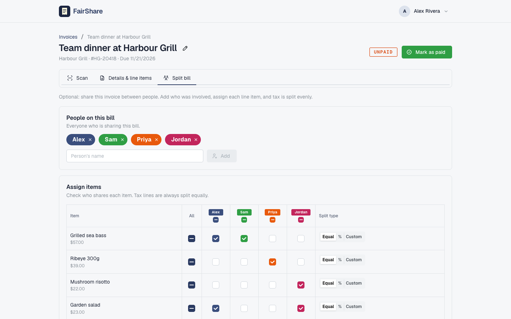
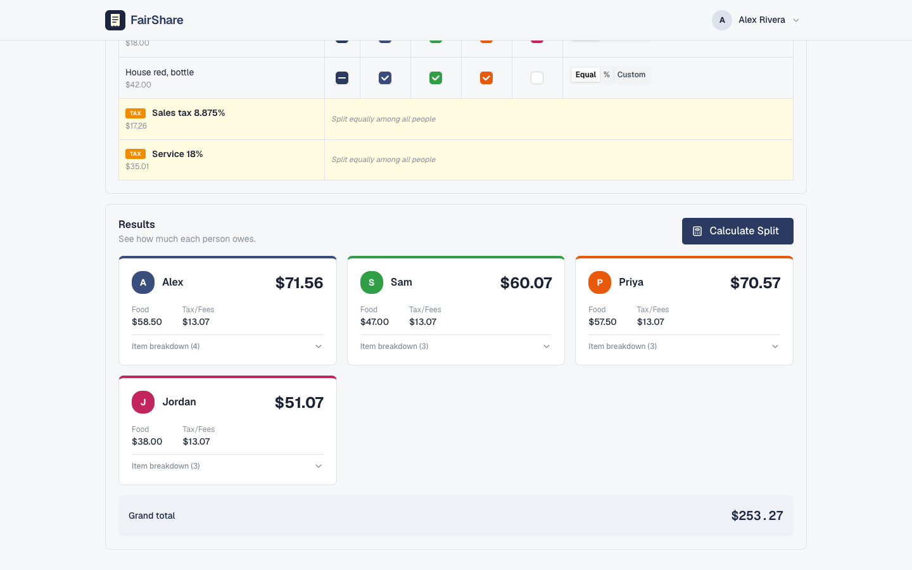
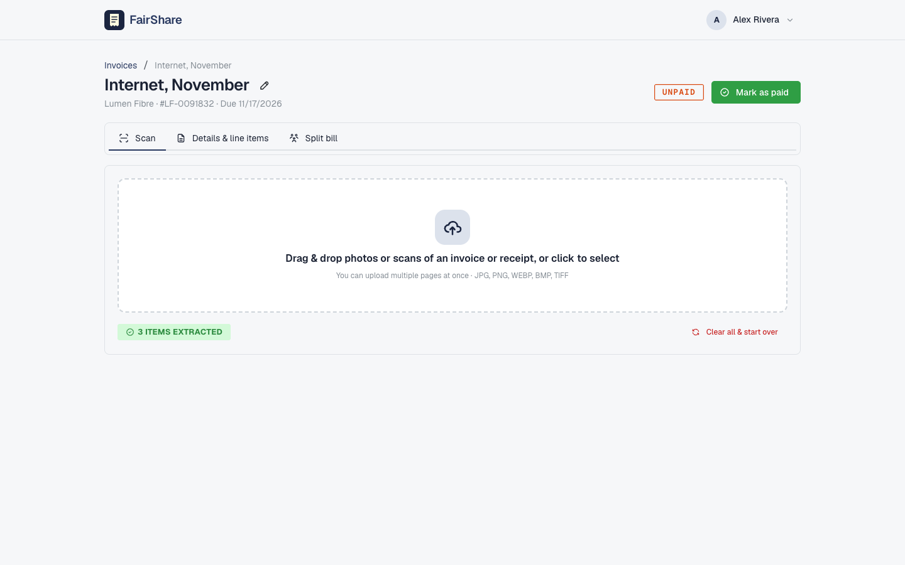
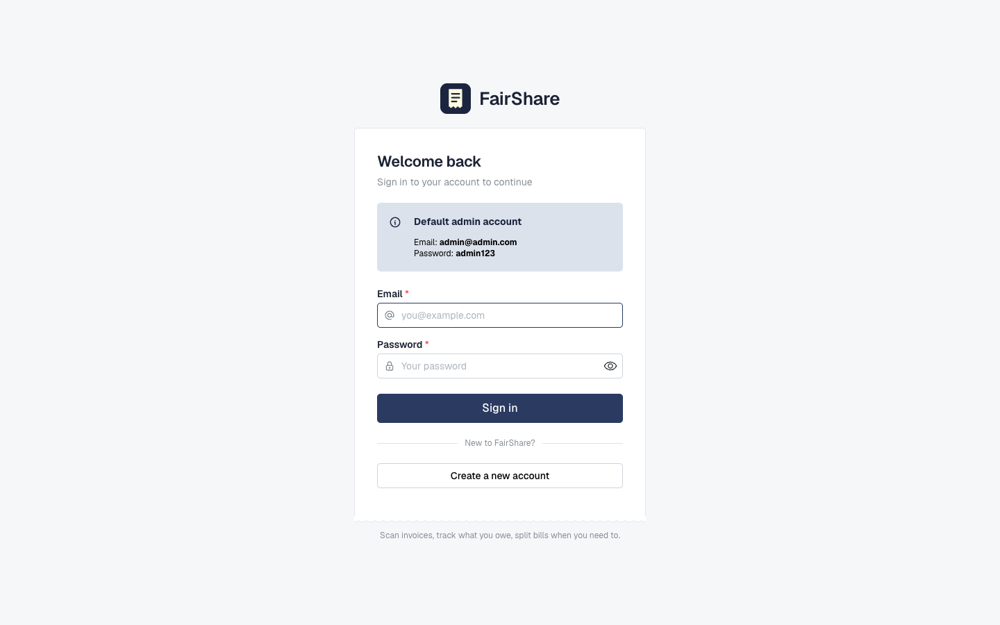
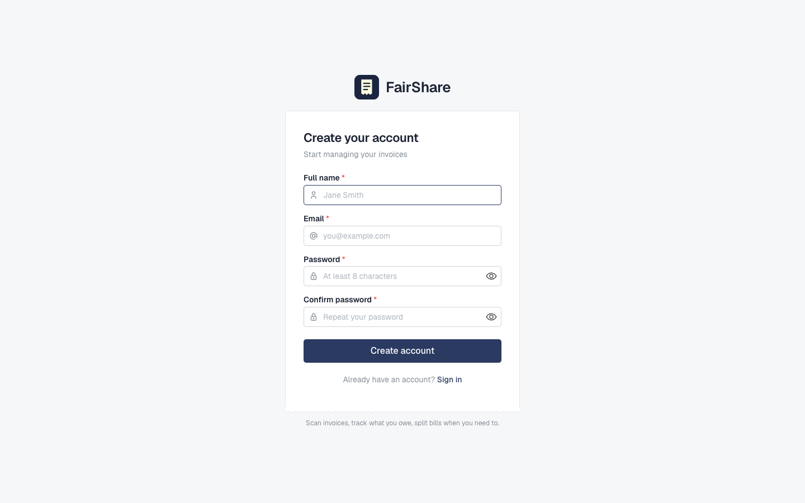
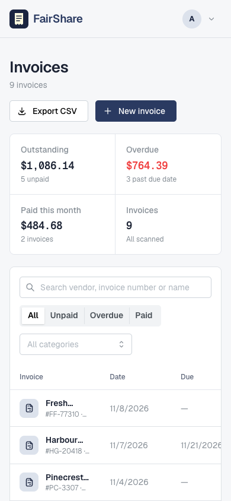

# FairShare

FairShare is an invoice management web app. Upload a photo or scan of an invoice or receipt, and OCR + an LLM extract the vendor, invoice number, dates, currency and every line item. Track what is unpaid or overdue, export to CSV, and, when a bill is shared, split it between people item by item.

## Screenshots



| | |
|---|---|
| <br><sub>Invoice details</sub> | <br><sub>Line items and totals check</sub> |
| <br><sub>Split a bill by item</sub> | <br><sub>What each person owes</sub> |
| <br><sub>Scan an invoice</sub> | <br><sub>Sign in</sub> |
| <br><sub>Create an account</sub> |  |



Screenshots use demo or dummy data.


## Features

**Invoices**
- **Scan to extract**: OCR ([EasyOCR](https://github.com/JaidedAI/EasyOCR)) reads the image and an LLM (OpenAI, `gpt-4o-mini` by default) turns it into structured data: vendor, invoice number, invoice and due dates, currency, printed total, and line items with tax lines marked. Multi-page invoices are supported.
- **Totals check**: the sum of the extracted line items is compared with the total printed on the invoice, and a warning shows any difference so a missed or misread line is caught.
- **Review and edit**: every extracted field and line item can be corrected. Scans only fill empty fields, so a rescan never overwrites your edits.
- **Payment tracking**: mark invoices paid or unpaid; anything unpaid past its due date shows as overdue.
- **Dashboard**: outstanding, overdue and paid-this-month amounts (kept separate per currency), with search and filters by status and category.
- **CSV export** of the filtered invoice list. Cells are escaped so values from scanned documents cannot run as spreadsheet formulas.

**Split bill (optional tab on each invoice)**
1. Add the people sharing the bill.
2. Assign each line item to one or more people, split equally, by percentage, or by custom amount.
3. Calculate: tax is split evenly, item costs follow the assignments, and a rounding pass makes individual totals add up exactly to the invoice total.

## Tech stack

**Backend** — Python / Flask
- `flask`, `flask-cors` — REST API
- `easyocr` — receipt text extraction
- `openai` — LLM-based receipt parsing
- `PyJWT`, `bcrypt` — authentication (access + refresh tokens, hashed passwords)
- `sqlite3` — storage (no external DB required)

**Frontend** — React / TypeScript
- `vite` — build tooling
- `@mantine/core`, `@mantine/notifications` — UI components
- `react-router-dom` — routing
- `zustand` — client state (auth + active bill)
- `axios` — API client
- `react-dropzone` — receipt image upload

## Project structure

```
FairShare/
├── backend/
│   ├── run.py                  # entry point (flask dev server, port 5000)
│   ├── requirements.txt
│   ├── app/
│   │   ├── __init__.py         # app factory, CORS, global JWT auth guard
│   │   ├── config.py           # env-based configuration
│   │   ├── database.py         # SQLite schema + migrations
│   │   ├── routes/             # auth, bills, persons, assignments, calculate, ocr, health
│   │   ├── services/           # auth_service, ocr_service, llm_service, split_service
│   │   └── middleware/         # per-route auth decorator
│   ├── data/                   # SQLite database file (gitignored)
│   └── uploads/                # uploaded receipt images (gitignored)
└── frontend/
    ├── src/
    │   ├── pages/               # HomePage, BillPage, LoginPage, RegisterPage
    │   ├── api/                 # axios wrappers per resource
    │   ├── store/                # zustand stores (auth, bill)
    │   ├── components/, hooks/, utils/, types/
    │   └── App.tsx               # routing + protected layout
    └── package.json
```

## Running with Docker (Windows and macOS)

Docker keeps everything that differs between Windows and macOS (`node_modules`, Python packages, native binaries, downloaded models) inside images and Docker volumes. OneDrive then syncs only source code and data, so an update made on one machine runs on the other after one command. Needs Docker Desktop.

```bash
docker compose up -d --build      # http://localhost:8083
```

- **Settings:** read from `backend/.env` (`OPENAI_API_KEY`, `JWT_SECRET`).
- **Data:** `backend/data` (the database) and `backend/uploads` (invoice images) are mounted from this folder, synced by OneDrive. EasyOCR's models are downloaded once into the `easyocr-models` Docker volume.
- **Port:** `FAIRSHARE_PORT=9000 docker compose up -d`.
- **After pulling or syncing an update:** run `docker compose up -d --build` again; only the changed layers rebuild.
- **Logs:** `docker compose logs -f backend`. **Stop:** `docker compose down`.
- **Live reload while editing:** `docker compose -f docker-compose.dev.yml up --build`, then open http://localhost:5183. Code changes on either machine reload the running app. The frontend's `node_modules` lives in a Docker volume and is reinstalled only when `package-lock.json` changes.

## Getting started

### Prerequisites
- Python 3.10+
- Node.js 18+
- An [OpenAI API key](https://platform.openai.com/api-keys) (for receipt parsing)

### Backend setup

```bash
cd backend
python -m venv .venv
.venv\Scripts\activate        # Windows (use `source .venv/bin/activate` on macOS/Linux)
pip install -r requirements.txt
```

Copy the example env file and fill in your values:

```bash
cp .env.example .env
```

```ini
DATABASE_PATH=data/fairshare.db
UPLOAD_FOLDER=uploads
FLASK_DEBUG=true

# Auth — change JWT_SECRET to a long random string in production
JWT_SECRET=CHANGE-THIS-IN-PRODUCTION
JWT_ACCESS_EXPIRY=900
JWT_REFRESH_EXPIRY=604800

# Required for receipt parsing
OPENAI_API_KEY=sk-...
OPENAI_MODEL=gpt-4o-mini
```

Run the server:

```bash
python run.py
```

The API is served at `http://localhost:5000/api`. The SQLite database is created automatically on first run, along with a seeded default account (`admin@admin.com` / `admin123`) for local testing.

### Frontend setup

```bash
cd frontend
npm install
npm run dev
```

The dev server runs at `http://localhost:5173` by default and proxies API calls to the Flask backend.

### Other frontend scripts

```bash
npm run build     # type-check and build for production
npm run lint       # run ESLint
npm run preview    # preview the production build locally
```

## API overview

All routes are prefixed with `/api`. Except for `auth/register`, `auth/login`, `auth/refresh`, and the `health` endpoints, every route requires a `Bearer` access token.

| Resource | Routes |
|---|---|
| Auth | `POST /auth/register`, `POST /auth/login`, `POST /auth/refresh`, `GET /auth/me` |
| Invoices (`bills`) | `GET/POST /bills`, `GET/PATCH/DELETE /bills/:id`, image upload/replace/delete under `/bills/:id/images/:filename`. `GET /bills` includes `total`, `tax_total` and `item_count`; `PATCH` accepts the invoice fields below |
| Items | `GET/POST/DELETE /bills/:id/items`, `PATCH/DELETE /items/:id` |
| Persons | `GET/POST /bills/:id/persons`, `DELETE /persons/:id` |
| Assignments | `GET /bills/:id/assignments`, `PUT/DELETE /items/:id/assignments`, `PUT/DELETE /bills/:id/assignments/person/:id` |
| OCR | `POST /ocr/upload` — runs OCR + LLM parsing on an uploaded receipt image |
| Calculate | `POST /bills/:id/calculate`, `GET /bills/:id/results` |
| Health | `GET /health`, `GET /health/llm` |

## Data model

SQLite tables: `users`, `bills`, `persons`, `bill_items`, `item_assignments`, `calculation_results`. Invoices are stored in the `bills` table (the API keeps the `/bills` paths). Besides its name and scan data, each invoice has `vendor_name`, `invoice_number`, `invoice_date`, `due_date` (YYYY-MM-DD), `currency` (ISO 4217), `category`, `notes`, `extracted_total` (the total printed on the invoice), `payment_status` (`unpaid`/`paid`) and `paid_at`. These columns are added automatically to existing databases on startup.

For bill splitting, each item can be split `equal`, `percentage`, or `custom` among assigned persons; tax lines are always split evenly across all persons on the bill.

## Tests

```bash
cd backend
python -m unittest discover -s tests -t .
```

The tests run against a temporary database and do not touch `data/fairshare.db`.

## Security notes

- Passwords are hashed with `bcrypt`.
- Auth uses short-lived JWT access tokens (15 min default) plus longer-lived refresh tokens (7 days default).
- Set a strong, random `JWT_SECRET` before deploying — the default value is only safe for local development.
- The seeded `admin@admin.com` account exists for local development convenience only; remove or change it before deploying anywhere reachable by others.
